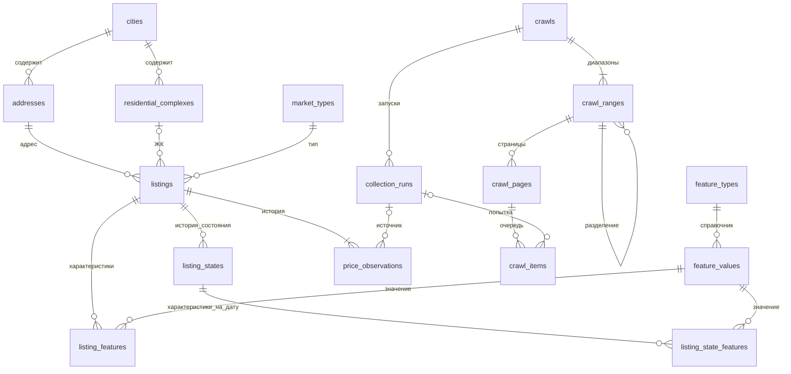

# Схема PostgreSQL

Операционные данные организованы в третьей нормальной форме. Каждая таблица описывает одну сущность; списки характеристик представлены связями, а цены — независимыми наблюдениями. JSON и строки с перечнями не используются как основное хранилище характеристик.

| Таблица | Данные и ключи |
|---|---|
| `cities` | Город, уникальное имя |
| `addresses` | Адрес; уникальна пара `(city_id, text)` |
| `residential_complexes` | Название ЖК; уникальна пара `(city_id, name)` |
| `market_types` | Два значения: `secondary` — вторичка, `new` — новостройка |
| `listings` | Уникальный `avito_id`, ссылка, заголовок, ссылки на адрес, ЖК и тип; комнаты, признак свободной планировки, площади, этаж, этажность, потолки, год постройки (необязательное целое); даты первого и последнего наблюдения, обновления источника |
| `feature_types` | Балкон/лоджия, дополнительно, тип комнат, санузел, окна, отделка, способ и условия продажи, тип дома, пассажирский лифт, парковка |
| `feature_values` | Одно значение характеристики; уникальна пара `(type_code, value)` |
| `listing_features` | Связь объявления и значения; составной первичный ключ `(listing_id, value_id)` |
| `listing_states` | Версия наблюдавшихся характеристик и архивного статуса; ссылка на объявление, момент наблюдения, ссылки на нормализованные адрес/ЖК/тип, скалярные параметры; индекс `(listing_id, observed_at, id)` |
| `listing_state_features` | Характеристики конкретной исторической версии; составной первичный ключ `(state_id, value_id)` |
| `collection_runs` | Ссылка на обход; очередь запусков, статус, даты, счётчики, сообщение; временный токен и дата связи с локальным браузерным сборщиком |
| `crawls` | Один обход города, исходный URL, состояние; граница переноса существующих объявлений из старой версии |
| `crawl_ranges` | Ключ `(crawl_id, number)`, родительский диапазон, включительные границы цены в рублях (`maximum = NULL` — без верхней границы), состояние и страница продолжения |
| `crawl_pages` | Ключ `(crawl_id, range_number, number)`, URL, отпечаток набора ссылок, трёхзначный признак следующей страницы (да/нет/неизвестно); внешний ключ на диапазон |
| `crawl_items` | Уникальная пара `(crawl_id, avito_id)`, URL, первая страница и порядок появления, состояние, последняя ошибка и запуск попытки; составной внешний ключ на страницу |
| `price_observations` | Ссылка на объявление и необязательная ссылка на запуск, целочисленная цена в рублях, дата наблюдения, дата обновления Авито на момент наблюдения |

Площади и высота хранятся в `NUMERIC`, цена — в `BIGINT` рублей без округления через float. Студия имеет `rooms = 0`. У свободной планировки `is_open_plan = true`, а `rooms = NULL`, если источник не указал число комнат. Если источник указал оба значения, сохраняются оба. Ограничение `rooms IS NOT NULL OR is_open_plan` допускает пустое число комнат только при явно установленном признаке свободной планировки; ноль вместо него не подставляется. Неизвестные необязательные значения — NULL. Для нескольких окон, дополнительных особенностей и условий продажи используются несколько строк связи, без значений через запятую внутри БД. UI собирает их в строку только для отображения.

Цены **не хранятся** одновременно в `listings` и истории: текущая цена — последнее наблюдение по `(observed_at DESC, id DESC)`. История содержит первую цену и каждое изменение; «дата проверки» не дублируется фиктивной записью с той же ценой. Дата обновления в наблюдении является историческим снимком значения на момент фиксации цены и может отличаться от текущей даты обновления в `listings`.

Внешние ключи предотвращают потерю связей; уникальный ID Авито исключает дубли объявлений. CHECK-ограничения проверяют положительные площади, цену, высоту и допустимую этажность. Частичный уникальный индекс разрешает не более одного запуска в состоянии `queued` или `running`. Индекс `(listing_id, observed_at, id)` ускоряет получение последней цены и истории. Блокировка на ID объявления защищает последовательность сравнения и добавления цены от конкурентных записей.

Адреса и названия ЖК дедуплицируются после удаления лишних пробелов; это не геокодер: разные написания одного адреса могут остаться разными строками справочника. Это не влияет на историю, поскольку её ключ — ID Авито. Два разных ID не объединяются автоматически, даже если совпадают адрес, этаж и площадь.

История накапливается с первого запуска программы. Из текущей карточки невозможно восстановить цены, которые были до начала наблюдений.

Успешная запись объявления и цены, а также перевод пункта очереди в `saved` выполняются одной транзакцией. Уже подтверждённые ID не открываются повторно внутри того же обхода. Новый полный обход создаёт новые пункты очереди для тех же ID, сохраняя общую историю цен. Очередь ссылается на ID источника, поскольку объявление ещё может не существовать в `listings`. Ошибки не теряются при перезапуске браузера. Частичный уникальный индекс разрешает не больше одного активного обхода.

Цена диапазона, курсор и состояние хранятся отдельно от объявления. Страницы разных диапазонов независимы, а очередь уникальна на весь обход города: объявления из родительской выдачи, соседних диапазонов и рекламных повторов не создают повторных пунктов. Составной внешний ключ очереди сохраняет связь с первой страницей обнаружения в том же обходе. Частичный уникальный индекс допускает один активный диапазон на обход. При разделении сохраняется родитель и создаются два дочерних диапазона без промежутка между границами; граница дорогого хвоста остаётся открытой. Эти операции подтверждаются вместе с выдачей следующего задания.

Цена за м² вычисляется в запросе из последней цены и `total_area`, с округлением до двух десятичных знаков. В таблице объявлений она не хранится. Тот же расчёт используется для фильтрации и сортировки, поэтому границы диапазона согласованы с отображаемым значением. Фильтры многозначных характеристик используют `EXISTS`, сохраняя одну строку на объявление и правильный счётчик результатов.

## Города и выборки (миграция 006)

`cities` хранит название, регион, необязательный ФИАС-ID и адрес раздела; уникальна пара названия и региона. `crawls.city_id` связывает очередь с городом, `mode` различает полный обход и выборку. `sample_plans` хранит этап и общее число объявлений; с миграции 009 также `probe_retries` — число неудачных перепроверок текущего счётчика. `sample_boundaries` хранит девять курсоров поиска децилей, `sample_probes` — принятые согласованные накопленные счётчики по верхней цене. Десять диапазонов выборки используют существующие `crawl_ranges`; одна очередь `crawl_items` гарантирует уникальность ID между группами. `not_selected` — кандидаты вне заполненной квоты, которые можно перенести в следующую группу при совпадении граничных цен. Производные показатели и цена за м² по-прежнему не дублируются в таблице объявлений.

## Архив и история характеристик (миграция 010)

`listings.is_archived`, `archived_at`, `archive_reason` описывают последнее обнаруженное состояние. Архив не удаляет запись или цены. `crawls.mode='refresh'` использует фиксированную очередь сохранённых актуальных ID выбранного города в тех же таблицах прогресса; страница-основание очереди локальная и никогда не запрашивается на Авито. `collection_runs.archived` считает переходы в архив за запуск.

Исторические параметры отделены от цен: `listing_states` содержит только изменения характеристик или статуса, цены остаются в `price_observations`. Значения категориальных характеристик переиспользуются через `listing_state_features`, адреса и ЖК сохраняют внешние ключи. Повторная проверка без изменений обновляет лишь время проверки. Изменения текущей проекции, версии, цены и очереди атомарны; операции одного Avito ID используют общий транзакционный lock.

Для месяца берётся последняя версия каждого ID по `(observed_at DESC, id DESC)` до начала следующего месяца в `Asia/Irkutsk`, затем историческая цена до того же момента. Фильтры статуса, характеристик и площади применяются к этой версии, а не к текущим полям объявления. Миграция создаёт исходные версии на `last_seen_at`, без выдуманной истории до последнего известного состояния.

## Рынок домов (миграция 011)

`property_kinds` — отдельный справочник рынков; `listings`, `listing_states`, `crawls` ссылаются на него. Прежние записи получают `apartment`. Ограничение активной очереди учитывает город, рынок и режим. Одновременно работает один сборщик.

Общая площадь используется как площадь квартиры или дома; числовые `land_area` (сотки), `distance_to_center_km` (расчётное расстояние), `source_distance_km` (данные Авито) добавлены в объявления и исторические снимки. Все удобства домов используют существующие нормализованные `feature_types` / `feature_values` / `listing_features`; исторические связи — `listing_state_features`. Списки коммуникаций не хранятся строкой JSON или дублирующей таблицей домов. Общая сводка коммуникаций формируется интерфейсом из отдельных полей.

`cities.population` хранит сведения встроенного справочника, `house_radius_km` — необязательное предпочтение пользователя. Фактический радиус фиксируется в `crawls.radius_km`. Незаданные вид жилья, готовность и комнаты дома не превращаются в выдуманную «вторичку» или студию. Для неизвестного рынка жилья есть значение справочника `market_types.unknown`.

Миграция 012: `listing_city_scopes` связывает дом с несколькими городскими зонами, хранит расстояние до каждого центра и дату первого наблюдения в этой зоне. `listing_state_scopes` сохраняет эти связи и расстояния в исторических снимках. Одна квартира/дом и одна история цен остаются привязанными к уникальному Avito ID; сбор дома из соседнего города не переносит и не дублирует запись. Историческая аналитика не добавляет городскую зону раньше её первого наблюдения.

Миграция 013 добавляет типы нормализованных характеристик `sale_scope`, `premise_kind`, `construction_status`, `district`. Явные сведения объявления хранятся через существующие `feature_values`/`listing_features`, исторические — через `listing_state_features`. Старые цены и снимки не переписываются для заполнения недоступных сведений. Признаки объекта продажи, назначения и готовности независимы.

`duplicate_reviews` хранит результат ручной проверки пары объявлений: составной первичный ключ `(left_id, right_id)`, ограничение `left_id < right_id`, два внешних ключа на объявления, решение `same`/`different`/`pending`, время и отпечатки обеих сторон. Адрес и площадь создают только кандидатов, отдельной сущности «квартира» автоматически не создаётся. В отпечаток не входит цена или дата очередной проверки; входят ключ адреса, площадь, комнаты/планировка, этажность, ЖК и категория предложения. Эти отметки не меняют историю цен, снимки, архивный статус или число объявлений.

## Надёжность очереди и решения о дублях (миграция 014)

`crawl_items.read_attempts` хранит число попыток чтения карточки, а `collection_runs.queue_revision` меняется при обработке очереди. Индекс `ix_crawl_pending_order` ускоряет поиск следующей ожидающей карточки.

`duplicate_reviews.id` — монотонный идентификатор события. По паре объявлений могут храниться отметка, изменение и отмена; порядок определяется `reviewed_at`, затем `id`. Существующие отметки сохраняются как первые известные события. `map_imports.attempts` и `retry_at` ограничивают повторы импорта карты.
